# Project 05/90 — Azure Network Security & Traffic Control

A hands-on Microsoft Azure project focused on securing cloud network infrastructure using Virtual Networks, Network Security Groups (NSGs), subnet-level security policies, and Azure Network Watcher.

The objective was to deploy an Ubuntu Linux Virtual Machine, configure controlled network access, expose a web server, restrict unauthorized traffic, and verify security rules through network diagnostics.

## Architecture Overview

The infrastructure consists of:

- Azure Virtual Network (VNet)
- Dedicated subnet
- Network Security Group (NSG)
- Ubuntu Linux Virtual Machine
- Static Public IP
- Nginx Web Server
- Azure Network Watcher

### Network Architecture

```text
                       Internet
                          |
                     Public IP
                          |
                  Azure Linux VM
                          |
                     Network NIC
                          |
                       Subnet
                          |
                 Network Security Group
                          |
             --------------------------
             |           |            |
           HTTP        HTTPS         SSH
           80           443           22
           Allow        Allow       Restricted
             |
            Nginx
             |
        Web Server
```

## Technologies & Services

| Technology | Purpose |
|---|---|
| Microsoft Azure | Cloud infrastructure |
| Azure Virtual Network | Network isolation |
| Azure Subnet | Network segmentation |
| Network Security Groups | Network traffic filtering |
| Azure Virtual Machine | Linux server hosting |
| Ubuntu Linux | Operating system |
| Nginx | Web server |
| Azure Network Watcher | Network diagnostics |
| PowerShell / SSH | Remote administration |

---

## 1. Virtual Network Configuration

Created an Azure Virtual Network to provide an isolated network environment for the project.

**Configuration:**
- VNet Name: `nsg-vnet`
- Address Space: `10.0.0.0/16`
- Subnet Name: `web-subnet`
- Subnet Address Range: `10.0.0.0/24`

### Address Space Configuration

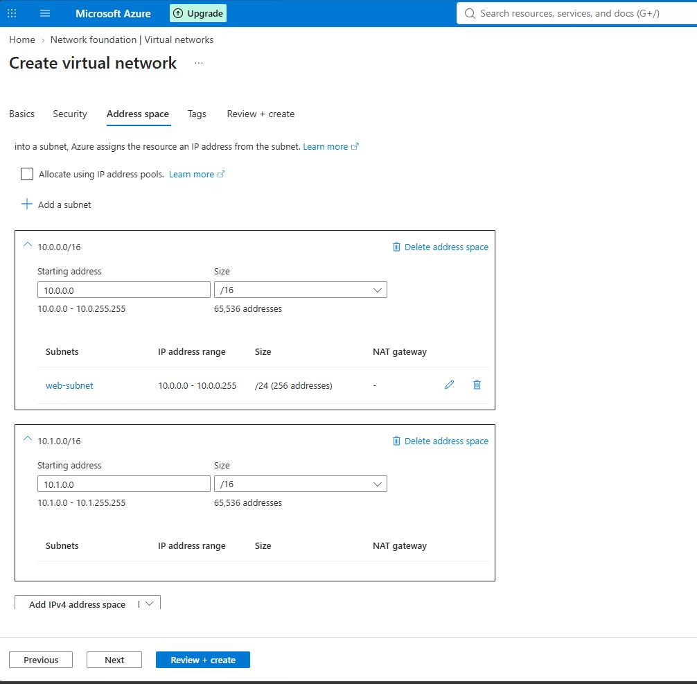

### Review and Create Virtual Network

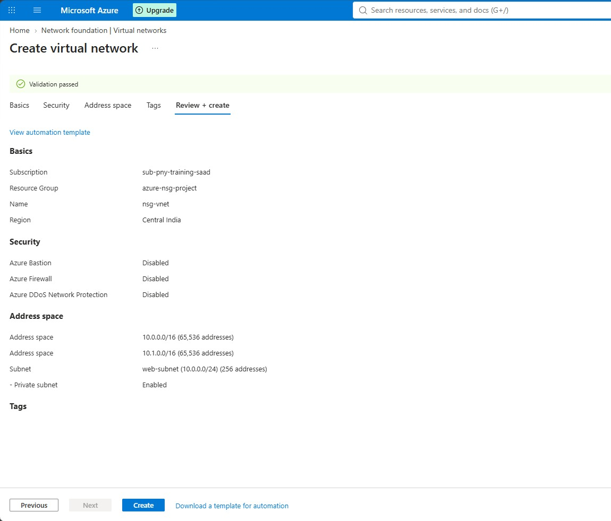

## 2. Network Security Group Configuration

Created a Network Security Group named `nsg-web-security` to control inbound and outbound network traffic.

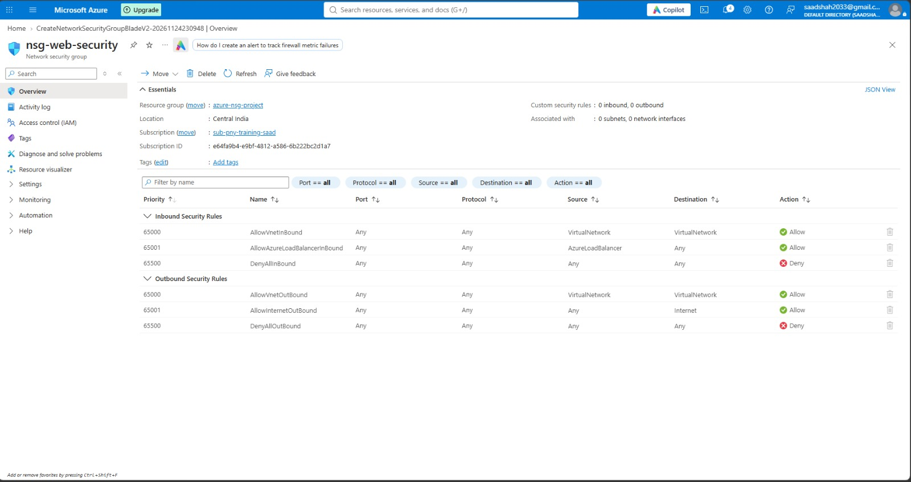

### Inbound Security Rules

Configured the following custom inbound rules:

| Rule Name | Port | Protocol | Source | Action |
|---|---:|---|---|---|
| Allow-HTTP | 80 | TCP | Any | Allow |
| Allow-HTTPS | 443 | TCP | Any | Allow |
| Allow-SSH-MyIP | 22 | TCP | My Public IP (/32) | Allow |
| Deny-Port-8080 | 8080 | TCP | Any | Deny |

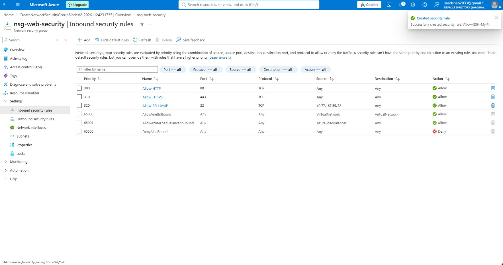

### NSG Subnet Association

Associated the NSG with `web-subnet` inside `nsg-vnet`.

This applies the security policies at the subnet level rather than directly at the VM's network interface.

### Outbound Security Rules

Reviewed Azure's default outbound security rules.

The default rules allow virtual network and internet-bound outbound traffic unless overridden by a higher-priority custom rule.

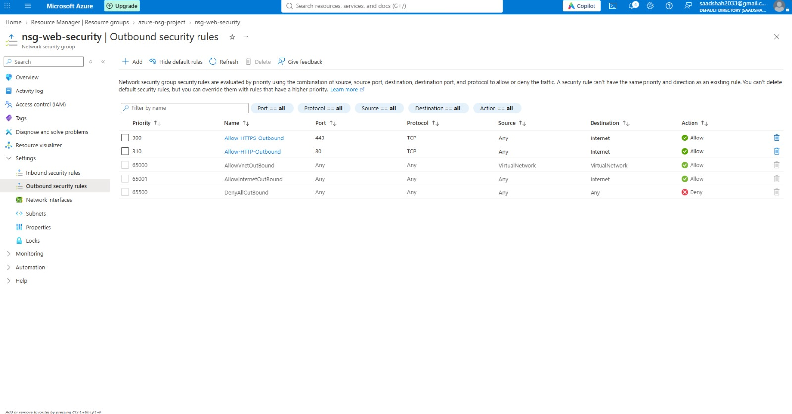

## 3. Virtual Machine Deployment

Deployed an Ubuntu Linux Virtual Machine inside the configured virtual network.

**Configuration:**
- VM Name: `azure-nsg-project`
- Operating System: Ubuntu Linux
- Virtual Network: `nsg-vnet`
- Subnet: `web-subnet`
- Network Security Group: `nsg-web-security` (subnet association)
- Remote Access: SSH

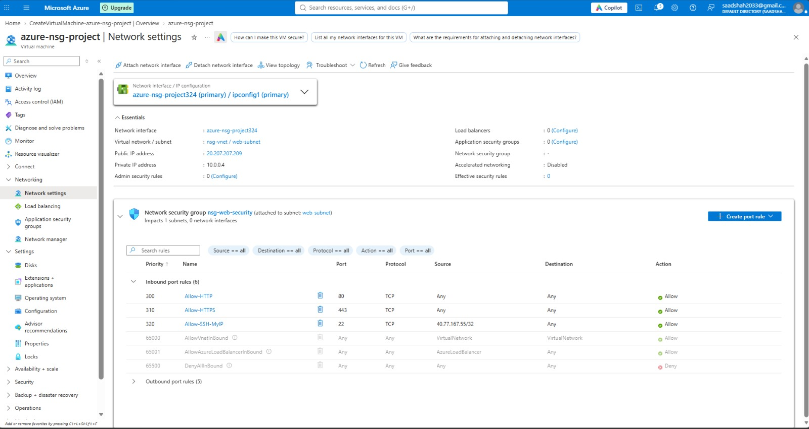

### SSH Connection

Connected to the Azure VM remotely using PowerShell and SSH.

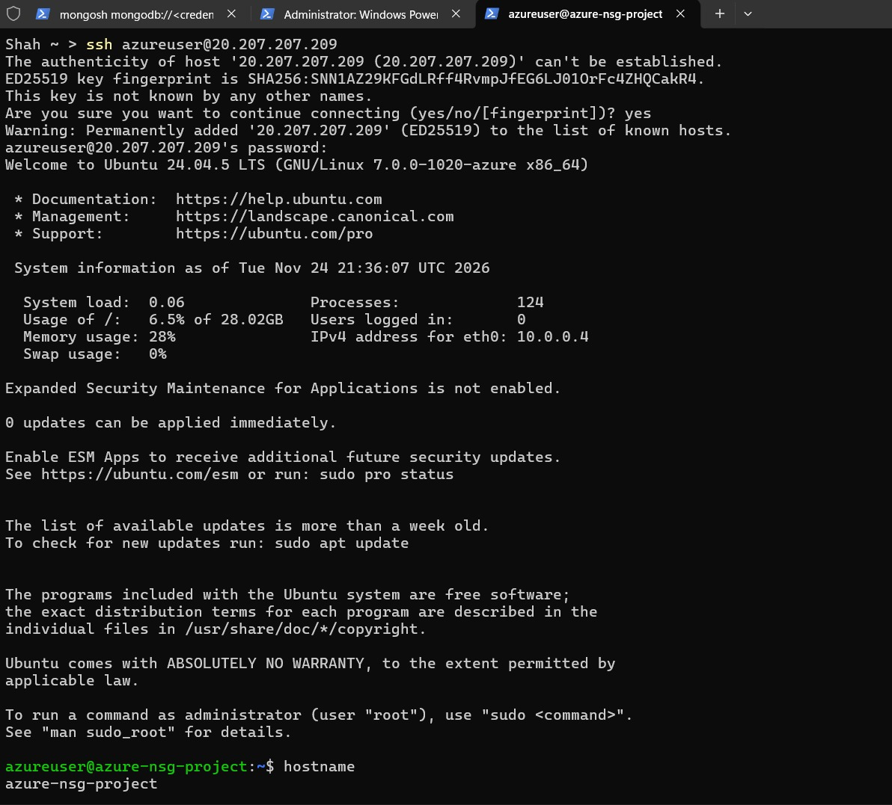

## 4. Nginx Web Server Deployment

Installed and configured Nginx on the Ubuntu VM.

### Installation Commands

```bash
sudo apt update
sudo apt install nginx -y
sudo systemctl start nginx
sudo systemctl enable nginx
sudo systemctl status nginx
```

Verified that the Nginx service was running successfully.

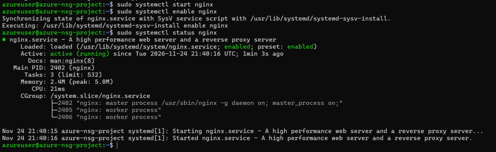

### Web Server Accessibility

Accessed the Nginx default welcome page using the VM's public IP address over HTTP.

This confirmed that inbound HTTP traffic on port 80 was permitted.

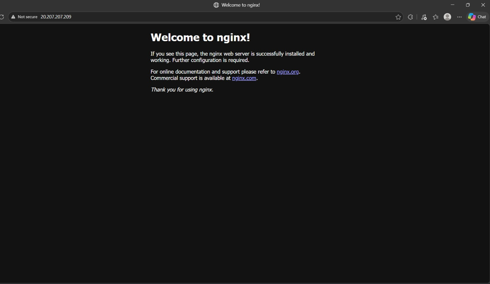

## 5. Custom Traffic Filtering — Port 8080

Created a custom inbound NSG rule to deny TCP traffic on port `8080`.

**Rule Configuration:**

| Setting | Value |
|---|---|
| Name | Deny-Port-8080 |
| Source | Any |
| Destination | Any |
| Destination Port | 8080 |
| Protocol | TCP |
| Action | Deny |
| Priority | 330 |

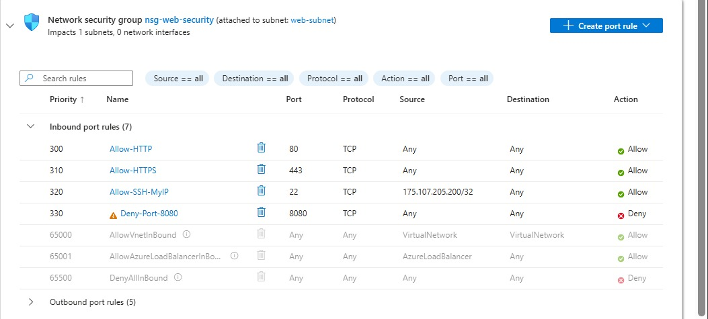

### Testing Port 8080

Started a temporary Python HTTP server on port 8080:

```bash
nohup python3 -m http.server 8080 --bind 0.0.0.0 >/tmp/port8080.log 2>&1 &
```

Attempted to access the service externally through the VM's public IP.

The connection failed because the NSG denied inbound traffic on port 8080.

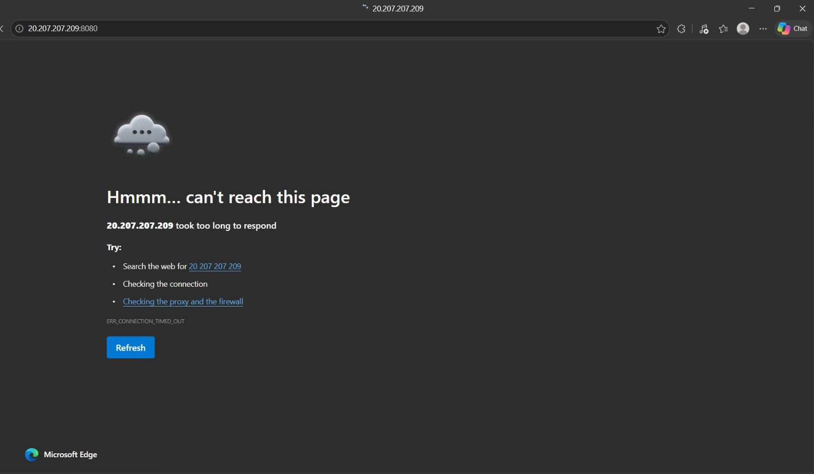

### HTTPS Testing

Attempted to access the VM using HTTPS.

The connection was unsuccessful because an HTTPS service and TLS certificate had not been configured.

The NSG's port 443 rule was subsequently verified independently using Azure Network Watcher.

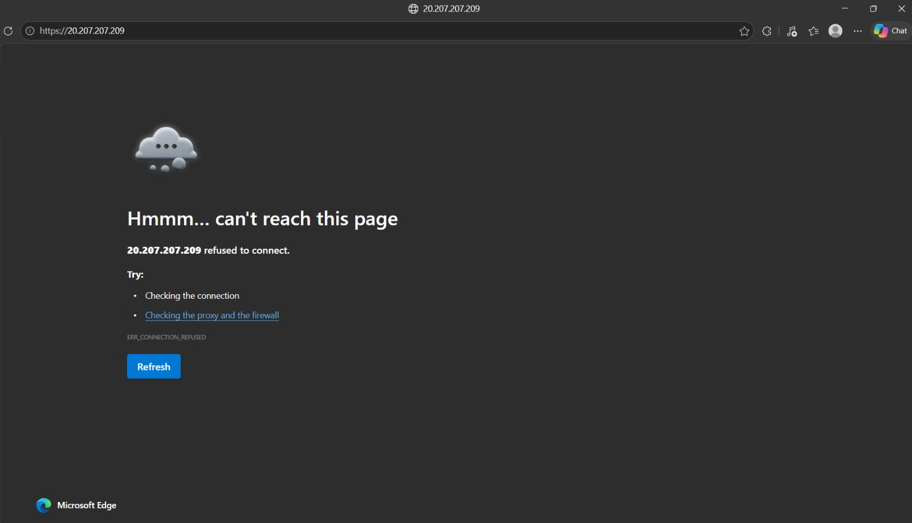

## 6. Azure Network Watcher — IP Flow Verify

Used Azure Network Watcher to verify whether specific network traffic was allowed or denied by the configured security rules.

### Port 8080 — Denied

Verified that TCP traffic on port 8080 was denied by the custom `Deny-Port-8080` rule.

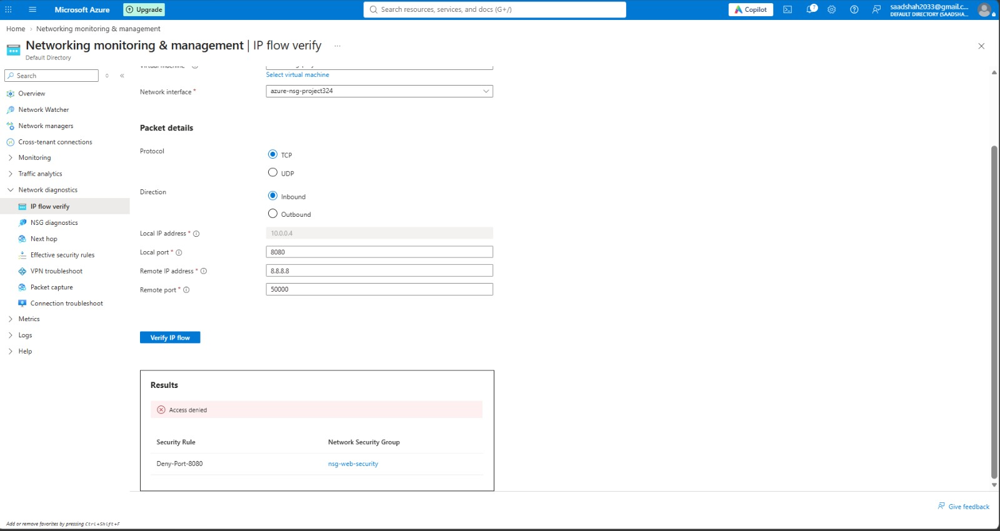

### HTTP Port 80 — Allowed

Verified that inbound HTTP traffic was permitted by `Allow-HTTP`.


### SSH Port 22 — Allowed

Verified that SSH traffic from the configured public IP address was permitted by `Allow-SSH-MyIP`.

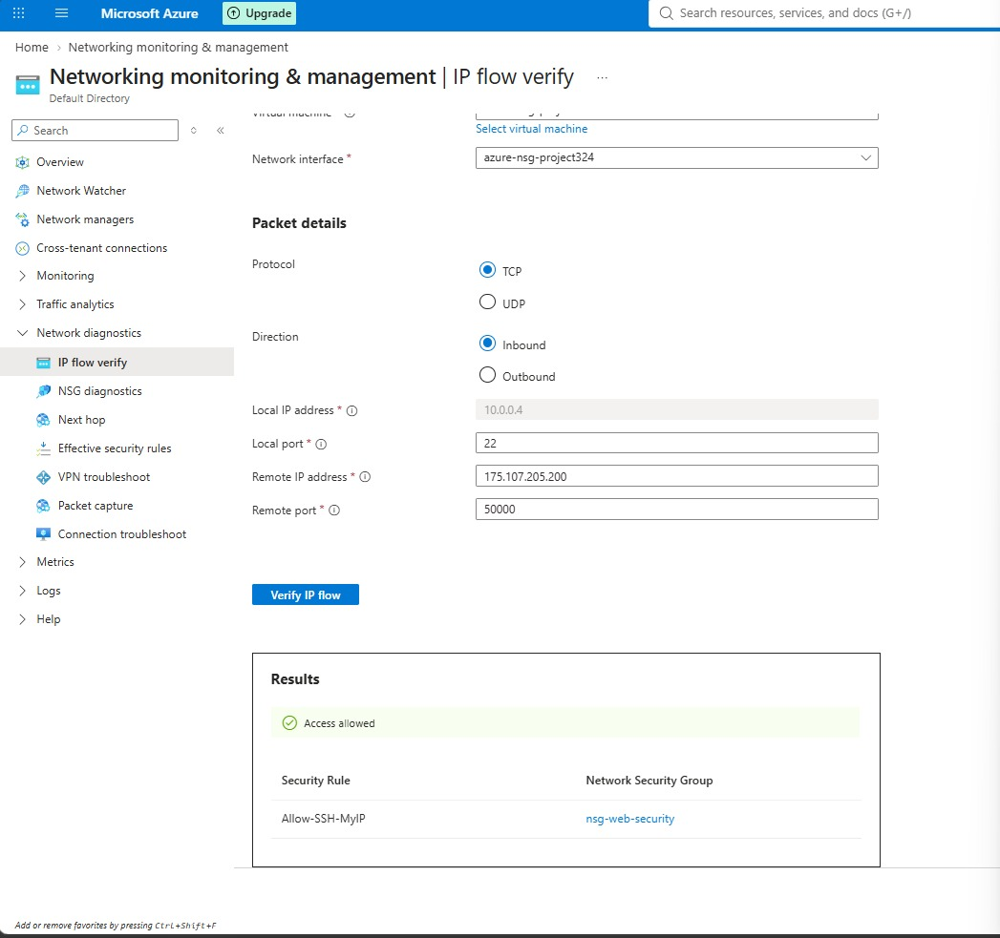

### SSH Port 22 — Unauthorized IP Denied

Tested SSH traffic from another remote IP address.

Azure Network Watcher confirmed that the connection was denied by the default `DenyAllInBound` rule because the remote IP did not match the configured SSH allow rule.

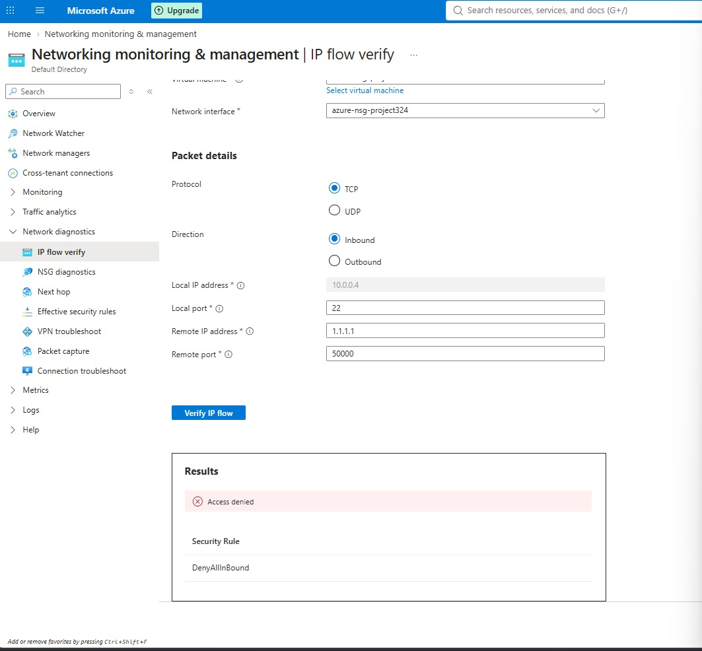

## 7. Security Configuration Summary

| Traffic Type | Port | Expected Result | Verification |
|---|---:|---|---|
| HTTP | 80 | Allow | Network Watcher |
| HTTPS | 443 | Allow | Network Watcher |
| SSH from configured IP | 22 | Allow | Network Watcher |
| SSH from unauthorized IP | 22 | Deny | Network Watcher |
| Custom test service | 8080 | Deny | Network Watcher |

**Important:** The HTTPS verification confirms that the NSG permits TCP traffic on port 443. It does not confirm that an operational HTTPS web server is running.

## 8. Key Learnings

Through this project, I gained practical experience with:

- Creating and configuring Azure Virtual Networks.
- Understanding IP addressing and CIDR notation.
- Configuring subnet-level Network Security Groups.
- Implementing inbound security rules and priorities.
- Restricting SSH access using public IP address ranges.
- Understanding default Azure NSG inbound and outbound rules.
- Deploying and managing Ubuntu Linux Virtual Machines.
- Installing and configuring Nginx.
- Testing allowed and denied network traffic.
- Using Azure Network Watcher IP Flow Verify.
- Troubleshooting cloud network connectivity.

## Project Outcome

Successfully deployed an Ubuntu Linux web server inside an Azure Virtual Network and implemented subnet-level network traffic filtering using Network Security Groups.

Validated HTTP, HTTPS rule permissions, restricted SSH access, and custom traffic denial through Azure Network Watcher.

This project strengthened my practical understanding of Azure networking, cloud infrastructure security, and network troubleshooting.

---

**Project:** 05/90  
**Category:** Cloud Engineering | Microsoft Azure  
**Focus:** Network Security, Traffic Filtering & Diagnostics
